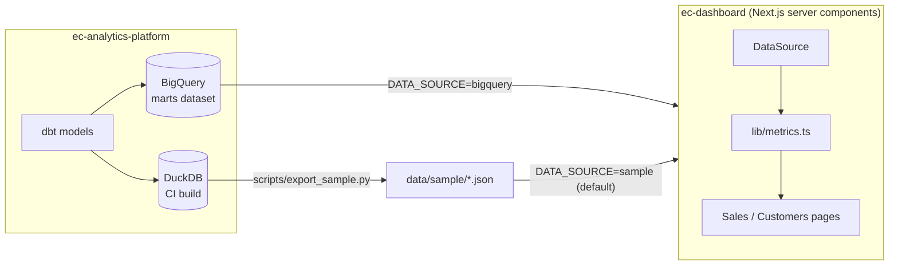

# ec-dashboard

[](https://github.com/yahayuta/ec-dashboard/actions/workflows/ci.yml)

A sales and customer dashboard for a multi-channel e-commerce business, built with
**Next.js (App Router)**, **React** and **TypeScript**. It reads the marts that
[ec-analytics-platform](https://github.com/yahayuta/ec-analytics-platform) builds with dbt,
either from **BigQuery** or from a bundled sample, so you can run it without a cloud account.

All data is synthetic.

## What it shows

**Sales** (`/`)

- Net revenue, orders, average order value, gross margin rate and cancelled/returned rate,
  each compared with the previous period of the same length
- Net revenue per day or week, one line per channel
- A channel table with share, AOV, margin rate and change vs the previous period
- Filters for period (30 / 90 / 365 days) and channel. They are plain links, so every view
  has a URL you can share

**Customers** (`/customers`)

- Size, revenue share and revenue per customer of each RFM segment, with the action each
  segment calls for
- An R × F matrix showing where the customers sit

## How it fits together



| Mart | Read as | Used for |
|---|---|---|
| `mart_daily_channel_sales` | day × channel rows | KPIs, trend chart, channel table |
| `mart_customer_rfm` | aggregated per R score × F score | Segment cards, R × F matrix |

## Design decisions

- **The dashboard does not redefine metrics.** "Net revenue counts completed orders only"
  is decided once in the dbt marts. The app only adds up mart rows and derives ratios
  (AOV, margin rate) from the totals, never by averaging daily ratios.
- **One interface, two data sources.** Pages depend on a small `DataSource` interface.
  `sample` decodes bundled JSON; `bigquery` runs two parameterized queries. Switching is
  one environment variable.
- **Server-side only data access.** Data is loaded in React Server Components, so
  credentials and SQL never reach the browser. The data module is marked `server-only`.
- **Safe SQL.** Values go through query parameters. Dataset and table names cannot be
  parameters, so they are validated against an identifier pattern before use.
- **Cheap to run.** BigQuery results are cached in memory for 10 minutes; the marts are
  rebuilt by a batch job, so querying on every page view would only add cost. Customer data
  is read as a 25-row aggregate, not one row per customer.
- **Reproducible periods.** "Last 90 days" ends on the latest date in the data, not on
  today, so the same data always gives the same numbers (the same rule the RFM mart uses).
- **No chart library.** The line chart and the matrix are small SVG/HTML components, which
  keeps the bundle small and the styling consistent in light and dark mode.

## From field problems to design decisions

| Problem in the field | Decision in this repository |
|---|---|
| Building each dashboard in a BI tool takes a lot of effort | Dashboard as code, split into small parts, so a change request becomes a small diff that AI can draft and a person can review |
| Teams report different revenue numbers | Metrics are defined once in dbt; the app only adds up mart rows |
| Ratios that look right but are not (averaging daily AOV) | Ratios come from totals; rate changes are shown in percentage points |
| Credentials or SQL reaching the browser | Data is read only in Server Components, in a `server-only` module |
| BigQuery cost growing with page views | Results are cached for 10 minutes; RFM is read as a 25-row aggregate |
| Numbers changing daily although the data has not | Periods end on the latest date in the data |

## How it was built

Built with an AI coding assistant (Claude) in under an hour, from the first request to a green CI run.

- **Me**: chose what to build and for whom, set the constraints (synthetic data only, no secrets,
  deploys must not break), checked the running app, and decided the direction.
- **AI**: proposed the design and wrote the code, tests, CI and this README.

## Tech stack

- **Next.js 16** (App Router, React Server Components), **React 19**
- **TypeScript 5.9** in strict mode with `noUncheckedIndexedAccess`
- **@google-cloud/bigquery** for the BigQuery data source
- **Vitest** for unit tests, **ESLint** with `eslint-config-next`
- **GitHub Actions** for CI, **Docker** (`standalone` output) for Cloud Run

## Tests

22 unit tests run with Vitest:

- **Metrics**: ratios come from totals, no division by zero, weekly buckets keep every row exactly once
- **Periods**: UTC date math across month ends and leap years, unknown query values fall back to the default
- **Sample data**: the bundled files decode, and their totals match the mart
- **BigQuery source**: unsafe dataset names are rejected, the lookback window is a query parameter,
  non-numeric values fail loudly, and the cache drops failures and expires

CI also starts the production server and requests every page, so a page that fails to render
breaks the build.

## Run it locally

Requires Node.js 20.9+.

```bash
git clone https://github.com/yahayuta/ec-dashboard.git
cd ec-dashboard
npm install
npm run dev          # http://localhost:3000, uses the bundled sample
npm run check        # lint, type check, unit tests, production build
```

## Use BigQuery

Build the marts with ec-analytics-platform first (see its README), then:

```bash
gcloud auth application-default login
DATA_SOURCE=bigquery BQ_PROJECT_ID=your-gcp-project BQ_DATASET=marts BQ_LOCATION=asia-northeast1 npm run dev
```

The account only needs read access to the marts dataset
(`roles/bigquery.dataViewer` on the dataset) and permission to run queries
(`roles/bigquery.jobUser` on the project). The Terraform in ec-analytics-platform grants
the first one to an optional analysts group.

## Deploy to Cloud Run

```bash
gcloud run deploy ec-dashboard --source . --region asia-northeast1 \
  --service-account dashboard-reader@your-gcp-project.iam.gserviceaccount.com \
  --set-env-vars DATA_SOURCE=bigquery,BQ_PROJECT_ID=your-gcp-project,BQ_DATASET=marts,BQ_LOCATION=asia-northeast1
```

The Dockerfile builds Next.js in `standalone` mode, so the image contains only the server
and the files it needs. Put the service behind IAP or another sign-in if the data is real.

## Refresh the sample data

```bash
# in ec-analytics-platform
make build
# in this repository
pip install duckdb
python scripts/export_sample.py ../ec-analytics-platform/dbt/ec_analytics.duckdb
```

## Repository layout

```
src/app/            pages (Sales, Customers) and global styles
src/components/     KPI card, line chart, filters, R × F matrix
src/lib/metrics.ts  aggregation and comparison logic (unit tested)
src/lib/period.ts   period handling in UTC dates
src/lib/data/       DataSource: sample, BigQuery, in-memory cache
data/sample/        marts exported from ec-analytics-platform (synthetic)
scripts/            sample export script
tests/              Vitest unit tests
```

Dependencies are pinned to exact versions in `package.json`.

Environment variables: `DATA_SOURCE` (`sample` or `bigquery`), `BQ_PROJECT_ID`, `BQ_DATASET` (default `marts`), `BQ_LOCATION`.

## Roadmap

- Product and category view on top of `fct_orders`
- Date range picker in addition to the fixed periods
- Playwright tests for the pages

## License

MIT
